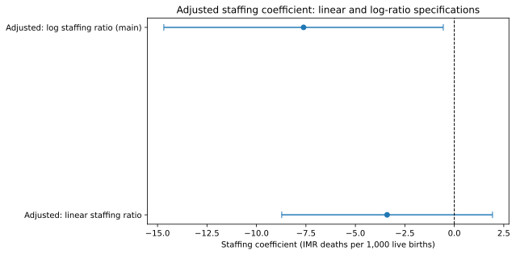

# Healthcare Access and Affordability in India

**An exploratory health-economics research project using official Indian public data**

This repository examines national health financing, state-level public health budgets, rural primary-care staffing, infant mortality and government hospital-bed availability. It combines National Health Accounts time series with state-level fiscal, workforce, socioeconomic and health-outcome indicators.

> **Research boundary:** this is a secondary-data, descriptive and correlational study. It does not estimate causal effects. National out-of-pocket expenditure (OOPE) shares are financing aggregates, not direct household-level measures of catastrophic health expenditure.

## Key findings

- India's OOPE share of total health expenditure fell from **64.2% in 2013–14 to 42.7% in 2023–24** (−21.5 percentage points). The government health expenditure share rose from **28.6% to 43.5%** (+14.9 percentage points).
- Across 31 states/UTs, the 2024–25 Revised Estimate for Medical and Public Health and Family Welfare averaged **6.1% of aggregate expenditure** (median 5.9%). This is a budget-composition measure, not spending per person or health-system performance.
- In the 2023 rural PHC staffing table, **10 of 34 matched states/UTs** with a calculable staffing ratio were below the reported doctor requirement; 24 were at or above it. The median in-position-to-required ratio was **1.38**.
- In the full 34-state/UT bivariate sample, the staffing ratio and 2023 infant mortality had Pearson r = **−0.538** and Spearman rho = **−0.562**. Excluding observations with fewer than 50 required PHC doctors (27 observations) gives Pearson r = **−0.498** and Spearman rho = **−0.368**.
- **Adjusted regression (32 complete cases):** on the same sample, the unadjusted staffing coefficient was **−6.19** (HC3 p = 0.0046); after controlling for log per-capita NSDP (2021–22) and NFHS-5 female literacy (2019–21), it fell to **−3.40** (HC3 p = 0.211; 95% CI −8.72 to 1.93). The bivariate relationship weakens and is no longer statistically distinguishable from zero at the 5% level after these controls. The exploratory model has R² = 0.523.
- Government hospital beds per 1,000 projected population (NHP-2023 bed counts, 31 Dec 2022, divided by NHP projected population as of 1 Mar 2021) have a state/UT median of **0.949** and mean of **1.285**. This is government-sector capacity only and uses a population denominator about 21 months earlier.

## Research questions and evidence coverage

| Research question | Evidence in this repository | Status |
|---|---|---|
| How has India's healthcare financing mix changed? | NHA national time series, 2013–14 to 2023–24 | Answered descriptively |
| How do states differ in public health budget priority? | RBI state expenditure shares, 2023–24 and 2024–25 RE | Answered descriptively |
| How does rural PHC doctor staffing compare with the stated requirement? | RBI Table 16, 2023 | Answered descriptively |
| Is rural PHC doctor staffing associated with infant mortality? | Same-year 2023 staffing and SRS IMR, 34 matched states/UTs | Bivariate and exploratory adjusted analysis |
| Does the staffing association persist after socioeconomic controls? | 2021–22 per-capita NSDP and NFHS-5 female literacy, 2019–21 | Exploratory; staffing coefficient attenuates and loses 5% significance |
| How do government hospital beds vary after population adjustment? | NHP-2023 bed counts and 2021 projected population | Answered descriptively; timing/source consistency caveats |
| What is the household incidence of catastrophic health expenditure? | Not measured by NHA aggregates | Not answered; requires household microdata |
| How do rural and urban households differ in utilisation and affordability? | Not measured in current state aggregates | Not answered; requires household/facility-level data |

## Conceptual framework

Healthcare financing affects resources available to providers and the extent of financial risk borne by households. Health-system capacity (including rural PHC staffing and hospital beds) is one channel through which resources may translate into service availability. Population health outcomes such as infant mortality are also shaped by nutrition, sanitation, maternal education, income, fertility, transport and wider state capacity.

This framework motivates the empirical comparisons but does not imply that the available data identify each causal pathway.

## Data sources

| Dataset | Period / unit | Source and role |
|---|---|---|
| National Health Accounts indicators | India, FY2013–14 to FY2023–24 | NHSRC / MoHFW; financing mix and OOPE |
| State public health expenditure share | 31 states/UTs, FY2023–24 and FY2024–25 RE | RBI *State Finances: A Study of Budgets 2025–26*, Statement 27 |
| Infant mortality rate | State/UT, calendar 2023 | SRS, reproduced in RBI *Handbook of Statistics on Indian States 2024–25*, Table 4 |
| Rural PHC doctor staffing | State/UT, calendar 2023 | RBI *Handbook of Statistics on Indian States 2024–25*, Table 16 |
| Per-capita NSDP | State/UT, FY2021–22, current prices | RBI *Handbook of Statistics on Indian States 2023–24*, Table 26 |
| Female literacy | Women aged 15–49, NFHS-5 2019–21 | IIPS / MoHFW, NFHS-5 India Report, Table 3.4.1 |
| Government hospital beds | State/UT, 31 Dec 2022 | CBHI, *National Health Profile 2023*, Table 6.2.2 |
| Population denominator for beds | State/UT, projected 1 Mar 2021 | CBHI, *National Health Profile 2023*, Table 1.1.2(d) |

Official references:
- [National Health Accounts, NHSRC](https://nhsrcindia.org/national-health-accounts-records)
- [RBI State Finances 2025–26, Statement 27](https://www.rbi.org.in/scripts/PublicationsView.aspx?id=23736)
- [RBI Handbook 2024–25, Table 4: Infant Mortality Rate](https://www.rbi.org.in/scripts/PublicationsView.aspx?id=23453)
- [RBI Handbook 2024–25, Table 16: Doctors and Specialists](https://www.rbi.org.in/Scripts/PublicationsView.aspx?id=23465)
- [RBI Handbook 2023–24, Table 26: Per-capita NSDP](https://nhm.tn.gov.in/wp-content/uploads/2026/Key_Statistics/RBI/RBI%20Statistics%20Handbook%202023-24.pdf)
- [NFHS-5 India Report, Table 3.4.1](https://dhsprogram.com/pubs/pdf/FR375/FR375.pdf)
- [National Health Profile 2023, CBHI](https://cbhidghs.mohfw.gov.in/sites/default/files/NHP/NHP-2023-Last-Final.pdf)

## Analysis and visualisations

### 1. National healthcare financing, 2013–14 to 2023–24


The OOPE share declined while the government share increased. These figures describe the source of health financing, not the distribution of financial hardship across households.

### 2. State public health expenditure share, 2024–25 RE


The variable is Medical and Public Health and Family Welfare expenditure as a percentage of aggregate state expenditure. Revised Estimates are not audited actuals. The percentage does not show absolute rupees, per-capita expenditure, expenditure as a share of GSDP or service quality.

### 3. Rural PHC doctor staffing and infant mortality, 2023


Notebook 06 constructs the ratio: `in-position rural PHC doctors / required rural PHC doctors`. The denominator is the source-reported administrative requirement (approximately one doctor per PHC), not population need. A ratio of 2 means about twice the benchmark post count—not twice the doctors the population needs. Small denominators can inflate ratios; the notebook reports a sensitivity sample excluding requirements below 50.

### 4. Adjusted workforce–IMR regression



Notebook 07 compares an unadjusted model and a model controlling for log per-capita NSDP (2021–22) and NFHS-5 female literacy among women aged 15–49 (2019–21). Both use HC3 heteroskedasticity-robust standard errors and the same 32 complete-case states/UTs. The staffing coefficient declines from −6.19 to −3.40 and its robust p-value rises from 0.0046 to 0.211. The adjusted 95% confidence interval includes zero. This suggests the bivariate relationship is partly accounted for by the included socioeconomic controls, but does not prove there is no staffing effect; the sample is small and important confounders remain omitted.

The restricted complete-case sensitivity sample with at least 50 required PHC doctors has 27 observations; its adjusted staffing coefficient is −7.79 (HC3 p = 0.0042). This contrast is a reminder that estimates are sensitive to sample definition and should be treated as exploratory.

### 5. Government hospital beds per 1,000 population


The numerator is government hospital beds in NHP-2023 Table 6.2.2, dated 31 December 2022. The denominator is projected population from NHP-2023 Table 1.1.2(d), as of 1 March 2021. The approximately 21-month gap is disclosed. The indicator covers government beds only, not private beds, occupancy, staffing, geographic access or quality.

**Source-table consistency caveat:** the 36 state/UT bed rows sum to 880,307, while the NHP India aggregate row reports 840,455. The 39,852 difference equals the Andhra Pradesh row. State-level rates use the published state rows; no national rate is calculated from these inconsistent totals.

## Repository structure

```text
.
├── Dataset/
│   ├── *.csv
│   ├── *_DATA_DICTIONARY.md
│   └── README.md
├── Notebooks/
│   ├── 01_National_Health_Accounts_Analysis.ipynb
│   ├── 02_State_Health_Expenditure_Analysis.ipynb
│   ├── 03_Health_Outcomes_and_Expenditure.ipynb
│   ├── 04_State_Hospital_Infrastructure_Analysis.ipynb
│   ├── 05_Correlation_and_Regression_Analysis.ipynb
│   ├── 06_Rural_Workforce_and_Health_Outcomes.ipynb
│   ├── 07_Adjusted_Workforce_IMR_Regression.ipynb
│   └── 08_Government_Hospital_Beds_Per_Capita.ipynb
├── Research_Report/
├── Visualisations/
├── scripts/
└── .github/workflows/
```

There is one canonical notebook directory. The duplicate notebook tree formerly stored under `Dataset/Notebooks/` and a malformed nested README file have been removed.

## Reproduce the analysis

Python 3.11 is recommended.

```bash
git clone https://github.com/gourisaini1/Healthcare-Access-And-Affordability-India.git
cd Healthcare-Access-And-Affordability-India
python -m venv .venv
# Activate the environment, then:
pip install -r requirements.txt
cd Notebooks
jupyter lab
```

Run notebooks 01–08 in order. Notebooks read source datasets from `../Dataset/`.

GitHub Actions validates datasets, checks notebook syntax and executes all notebooks. Executed notebook outputs are committed only for pushes to `main`; pull-request runs do not attempt to push.

## Limitations and next research steps

1. **Household affordability:** NHA OOPE shares are national aggregates. Catastrophic expenditure, impoverishment due to medical spending and distribution by consumption quintile require household-level NSS/NFHS-compatible data.
2. **Rural–urban access:** the PHC staffing table is rural-specific; the current project does not contain a comparable urban provider dataset or household utilisation data.
3. **Socioeconomic controls:** the adjusted workforce–IMR regression includes two controls only. Maternal health, nutrition, sanitation, fertility, urbanisation, transport and health-system quality remain omitted. NFHS-5 literacy and 2021–22 NSDP predate the 2023 outcome and are not exactly contemporaneous.
4. **Population adjustment:** the hospital-bed ratio uses a 2021 projected population denominator with 2022 bed counts. The NHP source also has an internal state-row versus national aggregate discrepancy, documented in Notebook 08.
5. **Causal inference:** the analyses are cross-sectional and observational. A causal evaluation would require a defensible identification strategy, not simply a larger regression.

## Project status

**Version 3 exploratory extension.** Eight notebooks now cover national financing, state budgets, rural PHC staffing, an exploratory adjusted regression and population-adjusted government hospital beds. Notebook execution and output saving are validated through GitHub Actions; the latest run status is linked below.

[Latest successful validation and notebook execution](https://github.com/gourisaini1/Healthcare-Access-And-Affordability-India/actions/runs/43886896461) · [All GitHub Actions runs](https://github.com/gourisaini1/Healthcare-Access-And-Affordability-India/actions)

---
**Author:** Gouri Saini | **Field:** Economics / Health Economics
