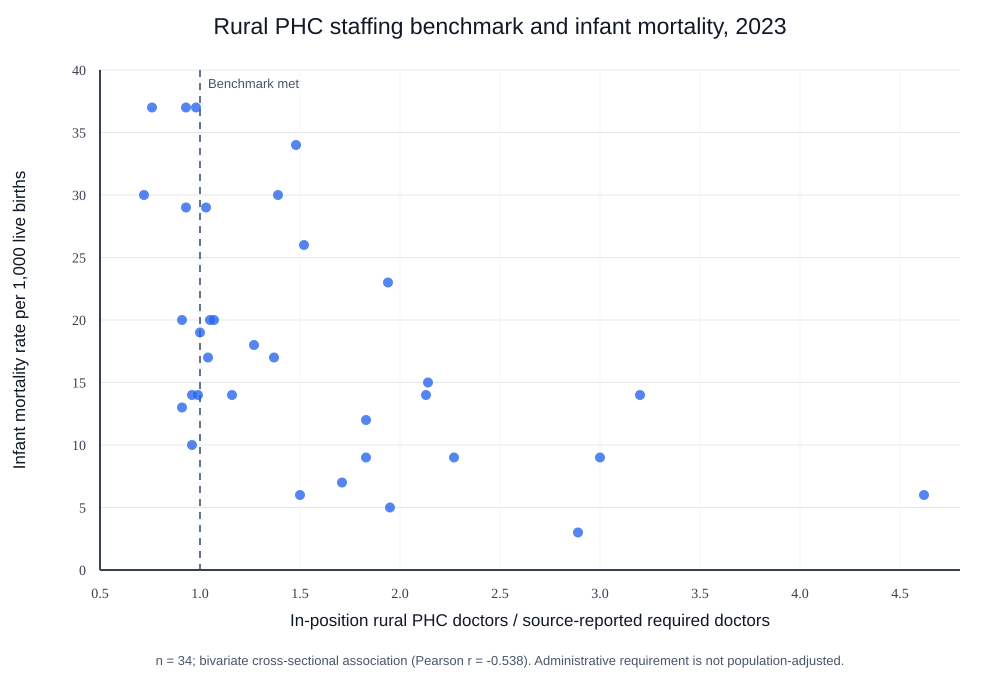
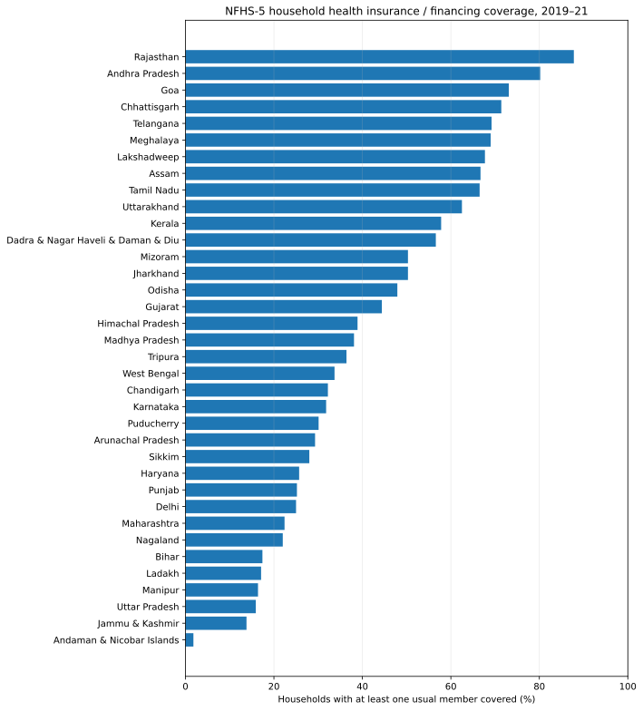
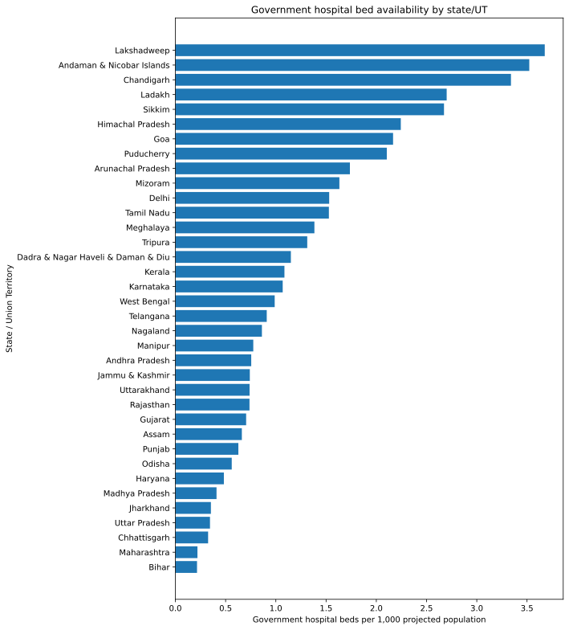

# Healthcare Access and Affordability in India

**An exploratory health-economics study using official Indian public data**  
**Author:** Gouri Saini

This project examines India's health-financing mix, state public-health budgets, rural primary-care staffing, infant mortality and government hospital-bed availability. It combines national time series with state/UT-level secondary data and reproducible analysis.

## Key findings

1. **National health financing:** India's out-of-pocket expenditure (OOPE) share of total health expenditure fell from **64.2% in 2013–14 to 42.7% in 2023–24**. The government share rose from **28.6% to 43.5%**.
2. **State health budgets:** Across 31 states/UTs, the 2024–25 Revised Estimate for Medical and Public Health and Family Welfare averaged **6.1% of aggregate expenditure** (median 5.9%).
3. **Rural PHC staffing:** Of 34 matched states/UTs with a calculable 2023 rural PHC staffing ratio, **10 were below** the source-reported doctor requirement. The median in-position-to-required ratio was **1.38**.
4. **Bivariate workforce–IMR relationship:** Staffing coverage and 2023 infant mortality were negatively correlated across 34 states/UTs (Pearson r = **−0.538**; Spearman rho = **−0.562**).
5. **Adjusted workforce–IMR association (32 states/UTs):** after controlling for per-capita NSDP and female literacy, higher rural PHC staffing remains associated with lower infant mortality in the main log-ratio model (**−7.62, 95% CI −14.7 to −0.6; p = 0.03**). Doubling the staffing ratio is associated with about **5.3 fewer infant deaths per 1,000 live births**. The result is sensitive to functional form and sample composition (linear ratio: −3.40, p = 0.21), so it is exploratory, not causal. [Full seven-specification robustness table](#4-adjusted-workforceimr-regression).
6. **Household financial-protection proxy:** NFHS-5 reports 41.0% of Indian households had at least one usual member covered by a health insurance/financing scheme. State/UT coverage ranges from **1.8% to 87.8%**; its Pearson correlation with nominal per-capita NSDP is **0.052** (p = 0.776; n = 33). This measures coverage reach, not adequacy of cover or actual out-of-pocket burden.
7. **Government hospital beds:** Across 36 states/UTs, the median was **0.949 government beds per 1,000 projected population**. Bed counts and population refer to different dates, and the source table has a documented reconciliation issue.

## Research questions

| Question | Evidence | Status |
|---|---|---|
| How has India's health-financing mix changed? | National Health Accounts, FY2013–14 to FY2023–24 | Descriptive |
| How do states differ in public-health budget priority? | RBI state expenditure shares, FY2023–24 and FY2024–25 RE | Descriptive |
| How does rural PHC staffing compare with reported requirements? | RBI rural PHC doctors, 2023 | Descriptive |
| Is staffing associated with infant mortality? | 2023 staffing and SRS IMR, 34 matched states/UTs | Bivariate association |
| Does the association persist after socioeconomic controls? | 2021–22 per-capita NSDP and NFHS-5 female literacy, 32 complete cases | Exploratory adjusted association |
| How does household insurance coverage vary across states/UTs? | NFHS-5, percentage of households with any usual member covered | Descriptive coverage proxy |
| How does government bed availability vary by population? | NHP-2023 bed counts and projected population | Descriptive |
| What is household catastrophic health expenditure by state? | Not measured in current data | Not answered |

## Data sources

| Dataset | Reference period | Official source |
|---|---|---|
| National health-financing indicators | FY2013–14 to FY2023–24 | [NHSRC / MoHFW National Health Accounts](https://nhsrcindia.org/national-health-accounts-records) |
| State public-health expenditure share | FY2023–24 and FY2024–25 RE | [RBI State Finances 2025–26, Statement 27](https://www.rbi.org.in/scripts/PublicationsView.aspx?id=23736) |
| State infant mortality rate | Calendar 2023 | [RBI Handbook 2024–25, Table 4 (SRS)](https://www.rbi.org.in/scripts/PublicationsView.aspx?id=23453) |
| Rural PHC doctors in position and required | Calendar 2023 | [RBI Handbook 2024–25, Table 16](https://www.rbi.org.in/Scripts/PublicationsView.aspx?id=23465) |
| Per-capita NSDP | FY2021–22, current prices | [RBI Handbook 2023–24, Table 26](https://nhm.tn.gov.in/wp-content/uploads/2026/Key_Statistics/RBI/RBI%20Statistics%20Handbook%202023-24.pdf) |
| Female literacy, women aged 15–49 | NFHS-5, 2019–21 | [NFHS-5 India Report, Table 3.4.1](https://dhsprogram.com/pubs/pdf/FR375/FR375.pdf) |
| Household health insurance/financing coverage | NFHS-5, 2019–21 | [NFHS-5 India Report, Table 11.15 and Figure 11.2](https://dhsprogram.com/pubs/pdf/FR375/FR375.pdf) |
| Government hospital beds | 31 December 2022 | [CBHI National Health Profile 2023, Table 6.2.2](https://cbhidghs.mohfw.gov.in/sites/default/files/NHP/NHP-2023-Last-Final.pdf) |
| Projected population | 1 March 2021 | CBHI National Health Profile 2023, Table 1.1.2(d) |

The CSV files, source notes, variable definitions and limitations are catalogued in [Dataset/README.md](Dataset/README.md). Missing source values are preserved rather than treated as zero. State-level indicators do not all refer to the same year or unit of analysis.

## Analysis and visualisations

### 1. National health-financing mix, 2013–14 to 2023–24


The OOPE share declined and the government share increased. These are national financing aggregates, not household-level catastrophic expenditure rates.

### 2. State public-health budget share, 2024–25 RE


The measure is Medical and Public Health and Family Welfare expenditure as a share of aggregate state expenditure. Revised Estimates are not audited actuals; this is not per-capita spending or a measure of service quality.

### 3. Rural PHC staffing and infant mortality, 2023



Staffing coverage is rural PHC doctors in position divided by the source-reported required doctor posts. It is not doctors per capita or a population-need measure. Small denominators can inflate the ratio.

### 4. Adjusted workforce–IMR regression


The preferred model uses the natural log of the staffing ratio, with controls for log nominal per-capita NSDP and NFHS-5 female literacy. The log coefficient of −7.62 means that doubling the staffing ratio (a change of \(\\ln 2\)) is associated with approximately **5.3 fewer infant deaths per 1,000 live births**, holding the controls fixed. The log specification was adopted after an initial linear-ratio analysis, following a robustness review; the linear result is reported alongside it for that reason. The main result is specification-sensitive and does not establish causality.

**Seven-specification robustness table (HC3 standard errors)**

| Specification | n | Coefficient | HC3 p-value | 95% CI |
|---|---:|---:|---:|---:|
| Linear ratio; full sample | 32 | −3.396 | 0.2114 | [−8.722, 1.930] |
| Log ratio; full sample (main) | 32 | −7.619 | 0.0345 | [−14.681, −0.557] |
| Linear ratio; required doctors ≥ 50 | 27 | −7.793 | 0.0042 | [−13.125, −2.460] |
| Log ratio; required doctors ≥ 50 | 27 | −10.868 | 0.0076 | [−18.843, −2.892] |
| Leave one out; most negative (exclude Goa) | 31 | −9.066 | 0.0246 | [−16.968, −1.163] |
| Leave one out; least negative (exclude Manipur) | 31 | −5.771 | 0.1594 | [−13.811, 2.268] |
| Log ratio; exclude Goa and Delhi | 30 | −11.246 | 0.0021 | [−18.398, −4.095] |

The 50-doctor threshold is a sensitivity check, not a formal statistical cutoff. Leave-one-out rows show the endpoints of the full one-state-at-a-time analysis. Linear and log coefficients have different units.

### 5. State-level household financial protection proxy and government hospital beds

#### NFHS-5 household health insurance/financing coverage, 2019–21



The indicator is the percentage of households with at least one usual member covered by any health insurance or financing scheme. Across 36 states/UTs, coverage ranges from 1.8% in Andaman & Nicobar Islands to 87.8% in Rajasthan. Among 33 states/UTs with a separate FY2021–22 per-capita NSDP observation, Pearson r = **0.052** (p = **0.776**). This weak cross-sectional correlation is descriptive; the coverage measure does not establish that insurance is adequate or that households avoid high out-of-pocket costs. See [Notebook 09](Notebooks/09_State_Health_Insurance_Coverage.ipynb) and the [data dictionary](Dataset/HEALTH_INSURANCE_COVERAGE_DATA_DICTIONARY.md).

#### Government hospital beds per 1,000 population



The numerator is government beds at 31 December 2022; the denominator is projected population at 1 March 2021. The approximately 21-month gap is disclosed. The published state/UT bed rows do not reconcile with the India aggregate; details are in Notebook 08 and the research report.

## Reproduce the analysis

Python 3.11 is recommended. From a terminal:

```bash
git clone https://github.com/gourisaini1/Healthcare-Access-And-Affordability-India.git
cd Healthcare-Access-And-Affordability-India
python -m venv .venv
# Activate the environment, then:
pip install -r requirements.txt
python scripts/validate_project.py
cd Notebooks
jupyter lab
```

Run notebooks **01–09 in numerical order**. Each notebook reads analysis-ready CSVs from `../Dataset/` and writes figures to `../Visualisations/`. GitHub Actions validates data and notebook syntax, executes the notebooks, and saves executed outputs on successful pushes to `main`.

## Limitations

- The NHA OOPE share is a national aggregate; household catastrophic expenditure and impoverishment are not measured.
- State budget shares describe budget composition, not per-capita expenditure, GSDP share or service quality.
- The PHC staffing denominator is the source-reported administrative requirement, not population need; the analysis covers rural PHC doctors only.
- The adjusted model is a small cross-section (32 observations) with two socioeconomic controls. Female literacy (2019–21) and NSDP (2021–22) predate the 2023 outcome; maternal health, nutrition, sanitation, fertility, urbanisation, transport and health-system quality remain potential confounders.
- The adjusted coefficient changes with functional form and sample composition. HC3 standard errors do not eliminate omitted-variable bias or establish causality.
- The hospital-bed rate combines different reference dates, excludes private beds and does not measure occupancy, staffing, quality or geographic access. The NHP state-row reconciliation issue is documented in Notebook 08.
- The NFHS-5 insurance indicator adds state-level coverage reach, but does not measure benefit adequacy, claims, out-of-pocket spending or catastrophic expenditure. Rural–urban utilisation and household-level financial burden remain unanswered.

## Further documentation

- [Full research report](Research_Report/Healthcare_Access_and_Affordability_India_Research_Report.md)
- [Notebook guide](Notebooks/README.md)
- [Dataset catalogue and data dictionaries](Dataset/README.md)
- [Visualisation catalogue](Visualisations/README.md)
- [Project status](PROJECT_STATUS.md)
- [GitHub Actions validation history](https://github.com/gourisaini1/Healthcare-Access-And-Affordability-India/actions)

---

**Field:** Economics / Health Economics
