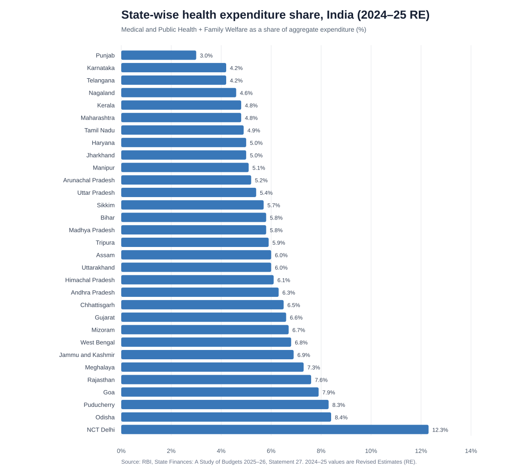

# Healthcare Access and Affordability in India

**An exploratory health-economics research project using official Indian public data**

This repository examines three linked dimensions of India's health system: **how healthcare is financed nationally, how public health resources vary across states, and whether rural primary-care staffing is associated with infant mortality**. It combines National Health Accounts time series with state-level fiscal, workforce and health-outcome indicators.

> **Research boundary:** this is a secondary-data, descriptive and correlational study. It does not estimate causal effects. National out-of-pocket expenditure (OOPE) shares are used to describe the financing mix; they are not a direct household-level measure of catastrophic health expenditure.

## Key findings

- India's OOPE share of total health expenditure fell from **64.2% in 2013–14 to 42.7% in 2023–24** (−21.5 percentage points). The government health expenditure share rose from **28.6% to 43.5%** (+14.9 percentage points). Source: National Health Accounts Estimates for India.
- Across 31 states/UTs, the 2024–25 Revised Estimate for Medical and Public Health and Family Welfare averaged **6.1% of aggregate expenditure** (median 5.9%). This is a budget-composition measure, not spending per person or health-system performance.
- In the 2023 rural PHC staffing table, **10 of 34 matched states/UTs** with a calculable staffing ratio were below the reported doctor requirement; 24 were at or above it. The median in-position-to-required ratio was **1.38**.
- Across 34 matched states/UTs, rural PHC doctor staffing coverage and 2023 infant mortality had a **Pearson correlation of −0.538** and **Spearman correlation of −0.562**. This is a meaningful descriptive association to investigate, not a causal estimate. It is not adjusted for income, maternal education, nutrition, sanitation, fertility, urbanisation or other confounders.

## Research questions and evidence coverage

| Research question | Evidence in this repository | Status |
|---|---|---|
| How has India's healthcare financing mix changed? | NHA national time series, 2013–14 to 2023–24 | Answered descriptively |
| How do states differ in public health budget priority? | RBI state expenditure shares, 2023–24 and 2024–25 RE | Answered descriptively |
| How does rural PHC doctor staffing compare with the stated requirement? | RBI Table 16, 2023 | Answered descriptively |
| Is rural PHC doctor staffing associated with infant mortality? | Same-year 2023 staffing and SRS IMR, 34 matched states/UTs | Explored statistically |
| How do government hospital and bed counts vary? | RBI Table 17 absolute counts | Described, with observation-year limitation |
| What is the household incidence of catastrophic health expenditure? | Not measured by the current NHA aggregate series | Not answered; requires household microdata |
| How do rural and urban households differ in utilisation and affordability? | Not measured in the current state aggregates | Not answered; requires household/facility-level data |
| Which socioeconomic factors explain state differences? | Not estimated in a multivariable model | Not answered; requires a harmonised state panel |

The repository deliberately distinguishes answered questions from questions requiring data that are not currently available in a comparable form. It does not present planned analysis as completed evidence.

## Conceptual framework

`Healthcare financing` affects the resources available to providers and the extent of financial risk borne by households. `Health-system capacity` (including rural PHC staffing) is one channel through which resources may translate into service availability. Population health outcomes such as infant mortality are also shaped by wider social determinants, including nutrition, sanitation, maternal education, income and transport.

This framework motivates the empirical comparisons but does not imply that the available data identify each causal pathway.

## Data sources

| Dataset | Period / unit | Source and role |
|---|---|---|
| National Health Accounts indicators | India, FY2013–14 to FY2023–24 | NHSRC / MoHFW; financing mix and OOPE |
| State public health expenditure share | 31 states/UTs, FY2023–24 and FY2024–25 RE | RBI *State Finances: A Study of Budgets 2025–26*, Statement 27 |
| Infant mortality rate | State/UT, calendar 2023 | SRS, reproduced in RBI *Handbook of Statistics on Indian States 2024–25*, Table 4 |
| Rural PHC doctor staffing | State/UT, calendar 2023 | RBI *Handbook of Statistics on Indian States 2024–25*, Table 16 |
| Government hospitals and beds | State/UT; source observation year not specified in RBI table | RBI *Handbook of Statistics on Indian States 2024–25*, Table 17 |

Official references:
- [National Health Accounts, NHSRC](https://nhsrcindia.org/national-health-accounts-records)
- [RBI State Finances 2025–26, Statement 27](https://www.rbi.org.in/scripts/PublicationsView.aspx?id=23736)
- [RBI Handbook Table 4: Infant Mortality Rate](https://www.rbi.org.in/scripts/PublicationsView.aspx?id=23453)
- [RBI Handbook Table 16: Doctors and Specialists](https://www.rbi.org.in/Scripts/PublicationsView.aspx?id=23465)
- [RBI Handbook Table 17: Government Hospitals and Beds](https://www.rbi.org.in/scripts/PublicationsView.aspx?id=23466)

## Analysis and visualisations

### 1. National healthcare financing, 2013–14 to 2023–24


The OOPE share declined while the government share increased. The NHA figures describe the source of health financing, not the distribution of financial hardship across households.

### 2. State public health expenditure share, 2024–25 RE



The variable is Medical and Public Health and Family Welfare expenditure as a percentage of aggregate state expenditure. Revised Estimates are not audited actuals. The percentage does not show absolute rupees, per-capita expenditure, expenditure as a share of GSDP or service quality.

### 3. State infant mortality rate, 2023


IMR is infant deaths per 1,000 live births. It is influenced by health services and broader social determinants.

### 4. Rural PHC doctor staffing and infant mortality, 2023

Notebook 06 constructs a staffing coverage ratio:

`In-position rural PHC doctors / required rural PHC doctors`

A ratio below 1 indicates fewer doctors in position than the reported requirement; a ratio above 1 indicates staffing above that requirement. This is an administrative staffing ratio, not doctors per capita or proof that services are accessible.

The analysis uses 34 state/UT observations with a positive reported requirement and matched IMR. Pearson and Spearman coefficients are reported in the notebook. The negative association is consistent with states having higher staffing coverage tending to have lower IMR in this sample, but it cannot isolate the effect of staffing from other state differences.

### 5. Government hospitals and beds


These are absolute counts. The RBI table does not state a distinct observation year, so the figures are not labelled as 2024–25 observations and are not interpreted as population-adjusted access.

## Repository structure

```text
.
├── Dataset/
│   ├── *.csv
│   ├── *_DATA_DICTIONARY.md
│   └── README.md
├── Notebooks/
│   ├── 01_National_Health_Accounts_Analysis.ipynb
│   ├── 02_State_Health_Expenditure_Analysis.ipynb
│   ├── 03_Health_Outcomes_and_Expenditure.ipynb
│   ├── 04_State_Hospital_Infrastructure_Analysis.ipynb
│   ├── 05_Correlation_and_Regression_Analysis.ipynb
│   └── 06_Rural_Workforce_and_Health_Outcomes.ipynb
├── Research_Report/
├── Visualisations/
├── scripts/
└── .github/workflows/
```

There is one canonical notebook directory. The duplicate notebook tree formerly stored under `Dataset/Notebooks/` and a malformed nested README file have been removed.

## Reproduce the analysis

Python 3.11 is recommended.

```bash
git clone https://github.com/gourisaini1/Healthcare-Access-And-Affordability-India.git
cd Healthcare-Access-And-Affordability-India
python -m venv .venv
# Activate the environment, then:
pip install -r requirements.txt
cd Notebooks
jupyter lab
```

Run notebooks 01–06 in order. Notebooks read source datasets from `../Dataset/`.

The GitHub Actions workflow validates the CSVs, checks notebook syntax and executes all notebooks on pushes and pull requests.

## Limitations and next research steps

1. **Household affordability:** NHA OOPE shares are national aggregates. Catastrophic expenditure, impoverishment due to medical spending and distribution by consumption quintile require household-level NSS/NFHS-compatible data.
2. **Rural–urban access:** the PHC staffing table is rural-specific, but the current project does not contain a comparable urban provider dataset or household utilisation data.
3. **Socioeconomic controls:** the workforce–IMR analysis is bivariate. A state panel with income, education, sanitation, nutrition and demographic controls is needed before estimating adjusted relationships.
4. **Population adjustment:** absolute hospital/bed counts are not per-capita measures. A compatible population denominator and observation year are required.
5. **Causal inference:** a causal evaluation would require a defensible identification strategy, not simply a larger regression.

## Project status

**Version 2 analytical expansion in progress.** The repository now has a consolidated notebook structure, a new same-year rural workforce analysis and tighter research-question scope. CI validation is used to check reproducibility; the final status will be updated after the expanded workflow passes.

---
**Author:** Gouri Saini | **Field:** Economics / Health Economics
