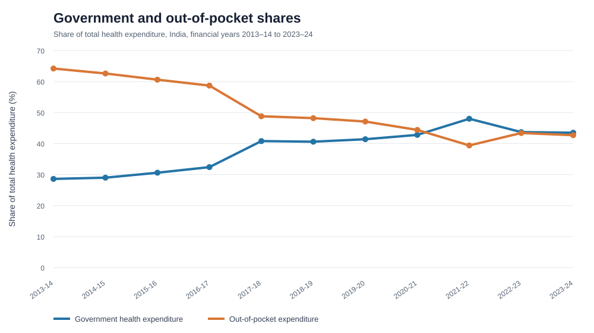
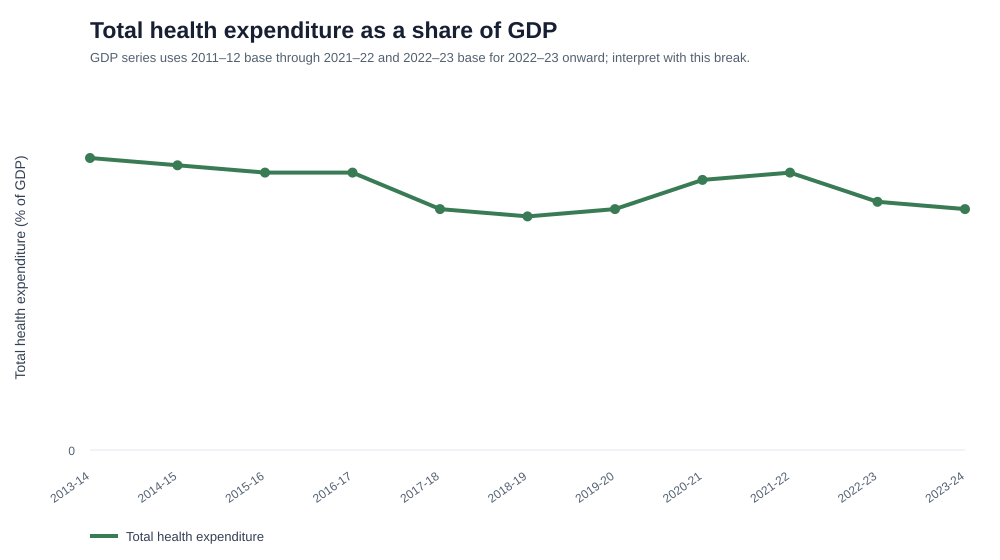
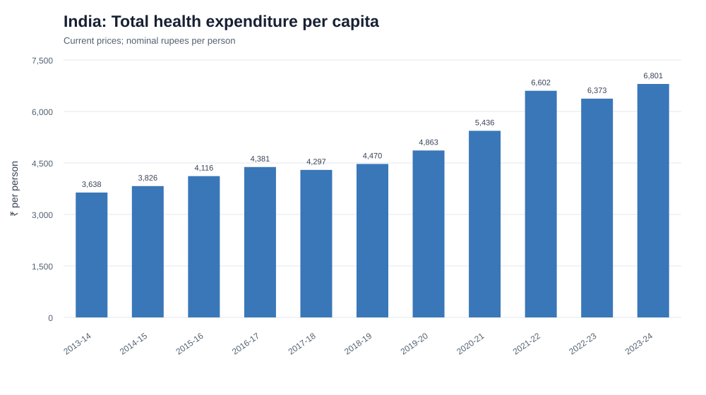
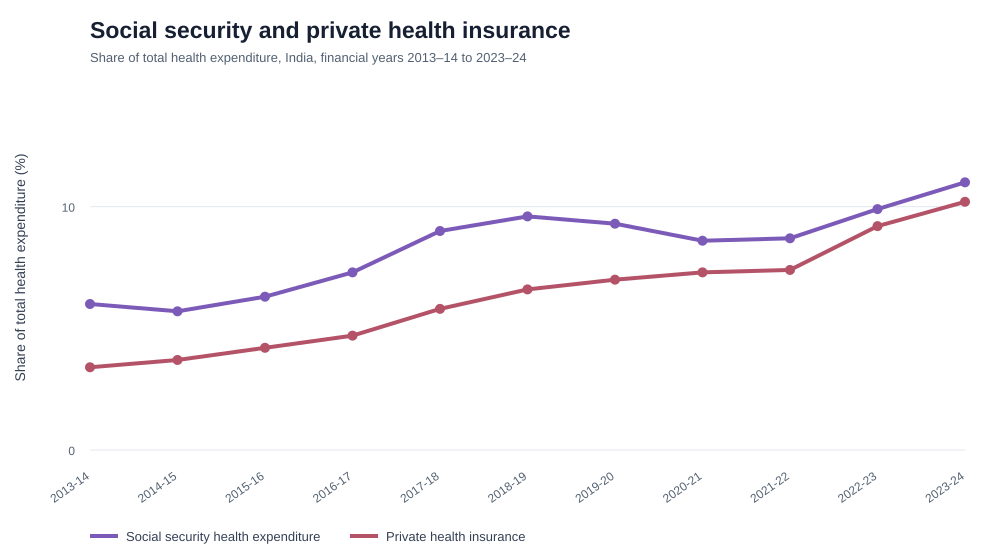

# Healthcare-Access-And-Affordability-India
### Project Overview
This project examines healthcare accessibility and affordability across India, focusing on regional disparities and socioeconomic differences.
## 1. Introduction

Healthcare is a fundamental determinant of human development and economic well-being. Access to affordable and quality healthcare influences labour productivity, household financial stability, poverty reduction and overall economic growth.

Despite improvements in India's healthcare infrastructure and public health financing, significant disparities persist in healthcare accessibility and affordability across geographical regions and socioeconomic groups.

High out-of-pocket expenditure (OOPE), unequal distribution of healthcare facilities, differences in household income and variations in public healthcare infrastructure continue to influence healthcare utilisation and financial protection.

According to the National Health Accounts Estimates for India 2021-22, out-of-pocket expenditure accounted for 39.4% of total health expenditure, while government health expenditure accounted for 48.0%.

These indicators highlight the importance of examining healthcare financing, accessibility and affordability together rather than treating them as separate challenges.

This project investigates the economic and structural determinants of healthcare accessibility and affordability in India using secondary datasets, statistical analysis and data visualisation.

## 2. Problem Statement

Healthcare accessibility is not determined solely by the availability of medical facilities. The affordability of treatment, geographical proximity, availability of medical professionals and household purchasing power also influence an individual's ability to obtain healthcare services.

In India, differences in healthcare infrastructure and household economic conditions can create unequal access to medical services.

Furthermore, high out-of-pocket healthcare expenditure can expose households to financial hardship, particularly when medical treatment is unexpected or prolonged.

This project seeks to examine these inequalities through an economic and data-driven framework, identifying regional disparities and exploring the relationship between healthcare infrastructure, expenditure and selected health outcomes.

## 3. Research Objectives

The primary objectives of this study are:

- To analyse regional disparities in healthcare accessibility across Indian states.
- To examine public and private healthcare expenditure patterns.
- To evaluate the financial burden of healthcare expenditure on households.
- To investigate differences in healthcare infrastructure between rural and urban regions.
- To examine the relationship between healthcare infrastructure and selected health outcomes.
- To identify socioeconomic factors associated with healthcare affordability.
- To develop evidence-based policy recommendations for improving healthcare accessibility and financial protection.

## 4. Research Questions

The study aims to investigate the following questions:

1. How does healthcare accessibility vary across Indian states?
2. What are the regional differences in healthcare infrastructure and availability of medical professionals?
3. How significant is out-of-pocket expenditure in India's healthcare financing system?
4. How do rural and urban populations differ in healthcare accessibility?
5. Is greater public healthcare infrastructure associated with improved health outcomes?
6. What socioeconomic factors influence household healthcare affordability?
7. What policy interventions could help reduce regional inequalities and financial barriers to healthcare?

## 5. Conceptual Framework

The study examines healthcare accessibility and affordability through four interconnected dimensions.

### 5.1 Healthcare Availability

Measures the availability and distribution of healthcare infrastructure, including:

- Primary Health Centres (PHCs).
- Community Health Centres (CHCs).
- Sub-Centres.
- District hospitals.
- Doctors and other healthcare professionals.

### 5.2 Healthcare Affordability

Examines the financial capacity of households to access medical services through:

- Out-of-pocket expenditure.
- Household healthcare expenditure.
- Government health expenditure.
- Health insurance coverage.
- Public healthcare financing.

### 5.3 Socioeconomic Inequality

Investigates how economic and demographic characteristics influence healthcare accessibility, including:

- Household income and economic status.
- Rural and urban population distribution.
- Regional economic disparities.
- Educational attainment.
- Population density.

### 5.4 Healthcare Outcomes

Examines selected health indicators to understand differences in population health across regions.

Potential indicators include:

- Infant mortality rate.
- Maternal mortality ratio.
- Life expectancy.
- Institutional delivery rates.
- Selected maternal and child health indicators.

## 6. Data Sources

The analysis uses publicly available secondary datasets from government institutions and international organisations.

| Data Source | Dataset / Information | Application |
|---|---|---|
| National Family Health Survey (NFHS) | NFHS-5 (2019-21) | Household characteristics, health indicators and healthcare utilisation |
| National Health Accounts (NHA) | National Health Accounts Estimates | Healthcare financing and out-of-pocket expenditure |
| Rural Health Statistics (RHS) | Rural Health Statistics reports | Healthcare infrastructure and human resources |
| Ministry of Health and Family Welfare | Health statistics and administrative reports | Healthcare infrastructure and policy data |
| World Bank Open Data | Health and socioeconomic indicators | Economic and demographic comparisons |

### Official Data Sources

- [National Family Health Survey](https://rchiips.org/nfhs/)
- [National Health Accounts, India](https://nhsrcindia.org/national-health-accounts-records)
- [Rural Health Statistics, 2021-22](https://www.mohfw.gov.in/sites/default/files/RHS%202021-22.pdf)
- [Ministry of Health and Family Welfare](https://mohfw.gov.in/)
- [World Bank Open Data](https://data.worldbank.org/)

## 7. Key Variables and Indicators

The following variables will be considered for the analysis.

| Category | Variables |
|---|---|
| Healthcare Expenditure | Total Health Expenditure, Government Health Expenditure, Out-of-Pocket Expenditure |
| Healthcare Infrastructure | Number of PHCs, CHCs, Sub-Centres and hospitals |
| Healthcare Workforce | Doctors, nurses and other medical professionals |
| Healthcare Accessibility | Facility availability and population coverage |
| Healthcare Outcomes | Infant mortality, maternal health and life expectancy |
| Socioeconomic Indicators | GDP per capita, literacy, population density and rural-urban distribution |

All variables will be assessed for consistency, availability, geographical coverage and comparability before being included in the final analysis.

## 8. Research Methodology

The project follows a quantitative research methodology combining descriptive statistics, exploratory data analysis and economic interpretation.

### 8.1 Data Collection

- Collect secondary datasets from government and international databases.
- Identify relevant state-level, district-level and national indicators.
- Examine the reporting periods and definitions of individual variables.
- Document the original sources and data collection methodology.

### 8.2 Data Cleaning and Preprocessing

- Identify and handle missing observations.
- Remove duplicate records.
- Standardise state and district classifications.
- Convert variables into consistent numerical formats.
- Check for outliers and inconsistencies.
- Merge datasets using appropriate geographical and temporal identifiers.

### 8.3 Exploratory Data Analysis (EDA)

Conduct exploratory analysis to identify patterns and variations in healthcare accessibility and expenditure.

The analysis will include:

- State-wise comparison of healthcare infrastructure.
- Distribution of healthcare expenditure.
- Comparison of rural and urban healthcare indicators.
- Examination of regional disparities.
- Analysis of healthcare workforce availability.

### 8.4 Descriptive Statistical Analysis

Apply statistical measures such as:

- Mean and median.
- Standard deviation.
- Minimum and maximum values.
- Percentiles.
- Correlation coefficients.

These measures will help understand the distribution and variation of healthcare indicators across regions.

### 8.5 Comparative Analysis

Conduct comparative analysis across Indian states and Union Territories to identify differences in healthcare availability, expenditure and selected health outcomes.

Where comparable data is available, rural and urban healthcare indicators will also be examined separately.

### 8.6 Economic Interpretation

Interpret the findings using concepts from:

- Health Economics.
- Public Economics.
- Development Economics.
- Welfare Economics.
- Socioeconomic Inequality.

The analysis will distinguish between observed associations and causal relationships.

## 9. Analytical Framework

The project will investigate the following relationships:

**A. Healthcare Infrastructure and Health Outcomes**

Examine whether regions with greater availability of healthcare facilities and medical professionals also demonstrate better health indicators.

**B. Healthcare Expenditure and Financial Protection**

Analyse the relationship between government healthcare expenditure and out-of-pocket expenditure.

**C. Socioeconomic Conditions and Healthcare Accessibility**

Examine how income levels, population distribution and regional economic conditions relate to healthcare access.

**D. Regional Healthcare Inequality**

Compare healthcare infrastructure, expenditure and selected health indicators across states to identify disparities.

## ## 10. Data Visualisation and Exploratory Analysis

The following figures are generated from the committed National Health Accounts dataset covering 2013–14 to 2023–24. They are national-level descriptive charts, not state-level comparisons.

### 10.1 Government and out-of-pocket expenditure



The chart tracks the shares of total health expenditure financed by government and paid directly by households. The latest observation is 2023–24.

### 10.2 Total health expenditure as a percentage of GDP



**Comparability note:** the National Health Accounts report uses GDP on the 2011–12 base through 2021–22 and GDP on the 2022–23 base for 2022–23 and 2023–24. The series break is noted in the chart and should be considered when interpreting changes.

### 10.3 Per-capita total health expenditure



Values are reported at current prices and are not adjusted for inflation. An increase in nominal per-capita expenditure therefore does not, by itself, establish an increase in real healthcare resources or affordability.

### 10.4 Social security and private health insurance



This figure compares the shares of total health expenditure attributed to social security health expenditure and private health insurance.

**Source:** National Health Systems Resource Centre (NHSRC), Ministry of Health and Family Welfare, *National Health Accounts Estimates for India 2023–24*, Tables 1 and 3. [Official report (PDF)](https://nhsrcindia.org/sites/default/files/2026-11/NHA%20Report%202023-24.pdf).

**Scope:** the latest National Health Accounts observation used here is 2023–24. These figures must not be described as 2024–25 data. The charts are descriptive and do not establish causal relationships.


## 11. Tools and Technologies

| Technology | Application |
|---|---|
| Python | Statistical computing and data analysis |
| Pandas | Data manipulation and preprocessing |
| NumPy | Numerical calculations |
| Matplotlib | Data visualisation |
| Seaborn | Statistical visualisation |
| Statsmodels | Statistical analysis |
| Jupyter Notebook | Interactive analysis and documentation |
| GitHub | Project documentation and version control |

## 12. Expected Research Contributions

The project aims to provide:

- A comparative assessment of healthcare accessibility across Indian states.
- Insights into the structure of healthcare financing in India.
- An examination of regional differences in healthcare infrastructure.
- An understanding of socioeconomic barriers to healthcare affordability.
- Evidence-based recommendations for strengthening healthcare access and financial protection.

## 13. Limitations of the Study

The study acknowledges the following limitations:

- The availability and reporting periods of healthcare datasets may vary.
- Differences in survey methodology may affect comparability across datasets.
- State-level indicators may conceal district-level inequalities.
- Administrative data may not fully capture actual healthcare utilisation or quality.
- Correlation between healthcare expenditure and health outcomes does not establish causation.
- The study relies on secondary data and is subject to the limitations of the original data sources.

## 14. Repository Structure

```text
Healthcare-Access-and-Affordability-India/
│
├── Dataset/
│   ├── Raw_Data/
│   └── Processed_Data/
│
├── Notebooks/
│   ├── 01_Data_Collection.ipynb
│   ├── 02_Data_Cleaning.ipynb
│   ├── 03_Exploratory_Data_Analysis.ipynb
│   └── 04_Statistical_Analysis.ipynb
│
├── Visualisations/
│
├── Research_Report/
│
├── README.md
│
└── requirements.txt
```

## 15. References

1. Ministry of Health and Family Welfare, Government of India. National Health Accounts Estimates for India 2021-22.
2. Ministry of Health and Family Welfare, Government of India. Rural Health Statistics 2021-22.
3. International Institute for Population Sciences (IIPS) and Ministry of Health and Family Welfare. National Family Health Survey (NFHS-5), 2019-21.
4. World Bank. World Development Indicators.
5. National Health Systems Resource Centre (NHSRC). National Health Accounts.

## 16. Author

**Gouri Saini**

Economics Graduate | Healthcare Economics | Data Analytics | Economic Research

---
